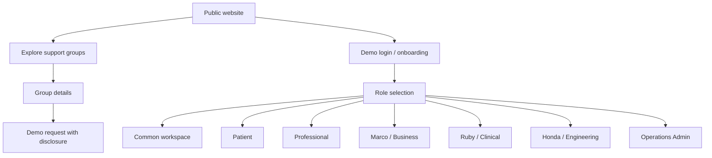
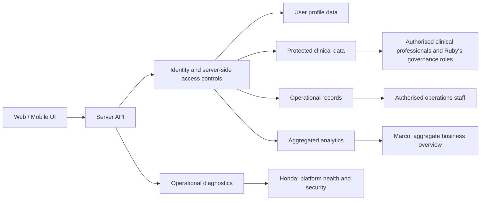

# Wasl — Developer Handoff

## 1. What has been delivered

A working static UX prototype with 11 public pages and seven role-specific dashboard workspaces. The dashboard workspace contains 48 distinct subpages, including its default overview pages, producing **59 total route renderers**.

**The experience is fictional throughout.** No server, user account, professional credential verification, clinical record, consent ledger, emergency response, payment processor, video service or external messaging service is connected.

## 2. Design system

| Token | Hex | Usage |
|---|---|---|
| Deep teal | `#276f67` | Primary links and buttons |
| Soft mint | `#e6f4ed` | Positive, calm surfaces |
| Soft lavender | `#f0ecfa` | Secondary panels / clinical quality |
| Pale peach | `#fff0e8` | Warm accents, gentle caution |
| Pale blue | `#e8f2f8` | Scheduling and technical information |
| Background | `#f8faf7` | Overall page background |
| Main ink | `#243c40` | Headlines and main text |
| Muted text | `#718184` | Secondary information |

Fonts: Manrope for headlines and DM Sans for body copy, with automatic system fallbacks. Layout uses `--max: 1200px`, a 252px dashboard sidebar, rounded 13–22px surfaces, and 12-column dashboard grids.

Illustration direction: custom SVGs using abstract mountains, sunrise, botanical shapes and non-identifiable symbols rather than generic medical stock imagery or distress-focused photographs.

## 3. Site structure

- **Public website:** brand narrative, clear service categories, sample group browsing, founder profiles, pricing hypotheses, educational resource previews, FAQ, contact and demo onboarding.
- **Common:** calendar, notifications, resources, profile examples, and access to role demos.
- **Patient:** groups, sessions, optional non-persistent check-in, participation story, resources and message previews.
- **Professional:** facilitation schedules, group occupancy, suitability review references, incident metadata and credential / education previews.
- **Marco:** revenue and operational metrics, marketing channels, partnership pipeline, strategy roadmap and reporting.
- **Ruby:** clinical governance, incident workflows, suitability review, team credential oversight, training, quality and protocols.
- **Honda:** infrastructure health, roadmap, deployments, security architecture, integration plans and event log examples.
- **Admin:** user registry, group catalogue, professional administration, fictional billing, support tickets and operational reporting.

## 4. Data structure and how to customise

`assets/js/data.js` contains the `window.WASL_DATA` object:

- `roles`, `groups`, `resources`, `faqs`, `notifications`, `sessions`
- `professionals`, `users`, `tickets`, `safety`, `screening`
- `finances`, `acquisition`, `roadmap`, `integrations`, `partnerships`, `training`

Data should remain fictional in a public prototype. Do not replace the mock object with real patient details.

## 5. Core application flow

## 6. Governance and data boundary (production design target)

The arrows above describe **future architecture**, not implemented controls.

## 7. Suggested conversion priorities

1. Obtain appropriate Egyptian legal and clinical advice; define service categories and permissible clinical practice.
2. Finalise group eligibility, professional credential validation, consent and safeguarding processes.
3. Select hosting, identity, backend framework, relational database and clear data classification rules.
4. Implement server-enforced permissions, audit logs, testing and security review; minimise access to sensitive health data.
5. Build booking, notifications, payment and provider integrations behind server APIs with safe failure behaviour.
6. Validate accessibility, Arabic localisation including full RTL support, usability and moderated pilot operations.

Nothing in the present static login or role picker should be carried over as a security control.
